# ERD backend hiện tại

19 thực thể nghiệp vụ và 2 bảng kỹ thuật AuthSession, RoleScoreSnapshot. Các tên PlayerStats,
InjuryHistory, ClubRequirement tương ứng PlayerSeasonStat, InjuryRecord,
ClubBudgetProfile trong tài liệu mới; giữ tên hiện tại để tương thích API.

```mermaid
erDiagram
  USER ||--o{ AUTH_SESSION : has
  USER ||--o{ CLUB_REQUIREMENT : creates
  USER ||--o{ SHORTLIST : owns
  USER ||--o{ SHORTLIST_ITEM : owns
  USER ||--o{ NOTIFICATION : receives
  USER ||--o{ MATCH_RESULT : saves
  USER ||--o{ AUDIT_LOG : performs
  USER ||--o{ MATCHING_INPUT : owns
  USER o|--o{ PLAYER_DATA_VERIFICATION : verifies_injuries
  USER o|--o{ PLAYER_DATA_VERIFICATION : verifies_registration
  CLUB ||--o{ CONTRACT : signs
  CLUB ||--o{ CLUB_REQUIREMENT : needs
  CLUB o|--o{ TRANSFER : from_club
  CLUB ||--o{ TRANSFER : to_club
  PLAYER ||--o{ CONTRACT : signs
  PLAYER ||--o{ PLAYER_STATS : has
  PLAYER_STATS ||--o| PLAYER_STATS_ESTIMATE : estimated_separately
  PLAYER_STATS ||--o| PLAYER_STATS_METRICS : v3_inputs_separately
  PLAYER_STATS ||--o{ ROLE_SCORE_SNAPSHOT : rebuildable_role_cache
  PLAYER ||--o{ INJURY_HISTORY : has
  PLAYER ||--o{ TRANSFER : has
  PLAYER ||--o{ SHORTLIST_ITEM : tracked
  PLAYER o|--o{ NOTIFICATION : concerns
  PLAYER ||--o{ MATCH_RESULT : evaluated
  PLAYER ||--o{ PLAYER_MARKET_VALUE_HISTORY : valued
  PLAYER ||--o{ MATCHING_INPUT : candidate
  PLAYER ||--o| PLAYER_DATA_VERIFICATION : verification
  SHORTLIST ||--o{ SHORTLIST_ITEM : contains
  CLUB_REQUIREMENT o|--o{ SHORTLIST_ITEM : linked
  CLUB_REQUIREMENT ||--o{ MATCH_RESULT : evaluated_for
  CLUB_REQUIREMENT ||--o{ MATCHING_INPUT : estimates_for
  SCORING_CONFIG ||--o{ MATCH_RESULT : config_version
```

## Bảng và vai trò

| Model Prisma | Bảng PostgreSQL | Vai trò |
| --- | --- | --- |
| Player | players | Hồ sơ cầu thủ, vị trí chính và mảng vị trí phụ |
| Club | clubs | Hồ sơ CLB |
| Contract | contracts | Hợp đồng |
| PlayerStats | player_stats | Thống kê cầu thủ/mùa |
| PlayerStatsEstimate | player_stats_estimates | Ước tính riêng cho các chỉ số còn thiếu, phương pháp và bằng chứng; không ghi đè quan sát |
| PlayerStatsMetrics | player_stats_metrics | Đầu vào /90 và tỷ lệ cho V3; nhãn nguồn, ước tính, checksum và căn cứ từng chỉ số |
| RoleScoreSnapshot | role_score_snapshots | Cache kỹ thuật theo thống kê/cấu hình/dataset; giai đoạn 1 V3 chỉ tạo cấu trúc, chưa lưu điểm |
| InjuryHistory | injury_histories | Các đợt chấn thương |
| User | users | Tài khoản |
| ClubRequirement | club_requirements | Nhu cầu CLB |
| Shortlist | shortlist_lists | Danh sách có tên của một User |
| ShortlistItem | shortlists | Mục cầu thủ trong danh sách; giữ bảng cũ và ID cũ |
| Transfer | transfers | Lịch sử chuyển nhượng, phí EUR, nguồn và độ tin cậy |
| Notification | notifications | Thông báo, eventKey và thời điểm đọc |
| ScoringConfig | scoring_configs | Trọng số, tham số và phiên bản cấu hình |
| MatchResult | match_results | Điểm, giải thích, dữ liệu đầu vào tại thời điểm chấm |
| AuditLog | audit_logs | Giá trị cũ/mới, người thao tác, thời điểm và IP |
| PlayerMarketValueHistory | player_market_value_histories | Lịch sử giá trị thị trường EUR theo ngày, nguồn và độ tin cậy |
| MatchingInput | matching_inputs | Phí EUR và lương EUR/năm dự kiến theo cầu thủ/yêu cầu CLB, kèm nguồn |
| PlayerDataVerification | player_data_verifications | Phạm vi lịch sử chấn thương đã xác minh và trạng thái hợp đồng/tự do tại một thời điểm |
| AuthSession | auth_sessions | Phiên đăng nhập kỹ thuật |

## Ràng buộc đáng chú ý

- Player và Club có `transfermarktId` tùy chọn, duy nhất, để nhập lại không tạo trùng; ID chính nội bộ không thay đổi. Trường này chỉ importer ghi, không nhận từ body CRUD.
- `Club.foundedYear`, `Player.height`, `Player.preferredFoot`, `Player.marketValue` cho phép null khi nguồn chưa biết; không dùng 0 hay số giả thay thế. Các quan hệ ERD không đổi.
- Mục Shortlist và danh sách phải cùng userId; nhu cầu gắn với mục phải thuộc cùng người đó.
- Mỗi user có tối đa một danh sách mặc định; migration chuyển mục cũ vào danh sách này.
- Không lưu trùng cầu thủ/nhu cầu trong cùng danh sách; cùng cầu thủ có thể ở các danh sách khác nhau.
- Không gửi trùng một Notification eventKey cho một User.
- Tổng trọng số ba trụ cột bằng 1, mỗi trọng số thuộc [0,1]; version >= 1.
- Tối đa một ScoringConfig đang active. Không sửa tham số của phiên bản đã có MatchResult;
  được phép đổi trạng thái active, hoặc tạo phiên bản mới.
- Các điểm MatchResult thuộc [0,100]. InputSnapshot giữ đầu vào cũ độc lập dữ liệu hiện tại.
- Ba cột điểm thành phần MatchResult cho phép null để chuẩn bị cho tiêu chí trọng số bằng 0; tổng điểm vẫn bắt buộc. Engine cũ vẫn chỉ lưu khi đủ cả ba thành phần.
- PlayerStats có `positionMinutes` và `positionMinutesSource` tùy chọn. API chỉ nhận phút nguyên không âm của 10 mã vị trí, tổng không vượt minutesPlayed, có nguồn khi có map. Vị trí phụ không chứng minh số phút.
- InjuryHistory có `bodyRegion` tùy chọn, không tự suy từ injuryType. Chưa có thông tin vùng thì để null.
- Phí Transfer không âm; CLB đi/đến khác nhau; FREE không ghi phí dương.
- Vị trí phụ không trùng nhau hoặc vị trí chính, dùng mã viết hoa; dữ liệu cũ mặc định mảng rỗng.
- Vị trí chính/phụ và vị trí yêu cầu CLB chỉ lưu 10 mã ST, LW, RW, CDM, CAM, CM, CB, RB, LB, GK. API quy đổi RWB/LWB→RB/LB, RCM/LCM→CM, CF/SS→ST và LM/RM→LW/RW trước khi ghi.
- Định giá không âm, có nguồn không rỗng; không trùng cầu thủ/ngày/nguồn, ngày định giá không sau ngày ghi nhận.
- MatchingInput thuộc chủ yêu cầu CLB, duy nhất mỗi cầu thủ/yêu cầu; có ít nhất một ước tính không âm và nguồn đi kèm. NULL khác phí/lương bằng 0.
- Xác minh chấn thương có đủ khoảng ngày, thời điểm, người xác minh và nguồn; FREE_AGENT/CONTRACTED phải có ngày hiệu lực và bằng chứng xác minh.
- Không có hồ sơ xác minh nghĩa là chưa biết; không tự coi cầu thủ tự do hoặc không từng chấn thương. Không tự dựng lại dữ liệu lịch sử từ dữ liệu cũ.
- AuditLog dùng entityType/entityId để tham chiếu nhiều loại dữ liệu, không có FK đa hình
  tới mọi bảng; việc ghi log tự động và bảo vệ thao tác log ở tầng ứng dụng chưa triển khai.

## Phạm vi API hiện tại

Đã có API Transfer, danh sách Shortlist, các mục ShortlistItem, Notification và ScoringConfig.
MatchResult có API đọc/xóa lịch sử; POST /api/matching/evaluate tạo điểm nội bộ khi save=true và đủ dữ liệu.
AuditLog chỉ có API đọc Admin và ghi nội bộ cho thay đổi Transfer/danh sách/ScoringConfig.
Chi tiết endpoint và giới hạn xem [API các thực thể](api/README.md#entities).
Ba bảng bổ sung cho Matching đã có API /market-value-history, /matching-inputs, /player-data-verifications; vị trí phụ nhập qua /players. Chi tiết ở [API các thực thể](api/README.md#entities).
Đã có engine F/S/R, tổng điểm và xếp hạng qua /api/matching; chưa tự chọn trọng số S/R hoặc nhập dữ liệu mẫu. Bản thử F riêng vẫn không lưu MatchResult. Chưa gửi push, Scheduler, Audit cho toàn bộ master hoặc xóa mềm. Xem [Matching API](api/README.md#matching) và [test F](testing/README.md#financial-fit).

V3 hiện hoàn thành [giai đoạn 1](data/README.md#v3-stage-1): registry ma trận, cấu hình và kiểm kê đầu vào. `GET /api/matching/v3/template` đọc hợp đồng cấu hình; chưa có API chấm điểm V3.
